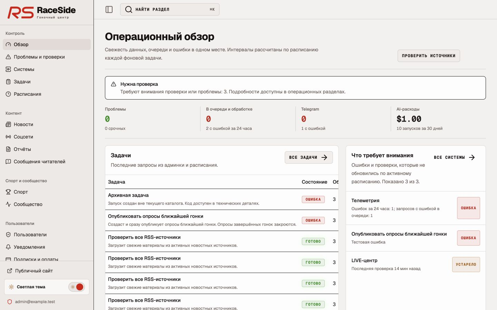
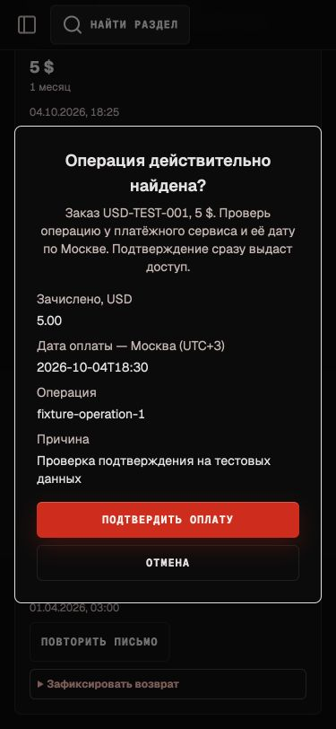
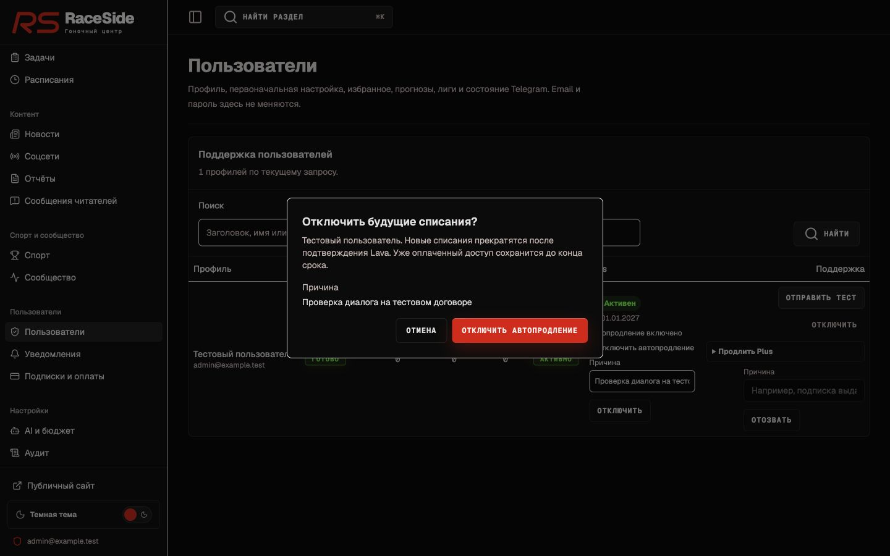

# Результаты реализации исправлений админки RaceSide

Дата: 4 октября 2026 года. Основа — [план A01–A19](admin-corrections-implementation-plan.md).

**Выбранные исправления реализованы в локальном коде. Миграция не применена к рабочей базе, процессы не опубликованы.** Настройки production, исторические записи, тарифы, спортивные результаты и решения пользователей не изменялись. Реальные Telegram-доставки, ручные оплаты, возвраты, публикации и отмены договора не выполнялись.

## Что реализовано

| Пункт | Изменение и подтверждение |
| --- | --- |
| A01 — Telegram | Тест и повтор используют `pending`, фильтры учитывают `sending` и `cancelled`. Повтор условно меняет только `failed` без `sent_at`, очищает ошибку и попытки. Получение записи перед отправкой атомарно: два диспетчера не отправляют одну запись одновременно. Тест проверяет активную связь, настройки Telegram и Plus. Проверены статусы и конкурентное получение; реальная доставка остаётся приёмкой после выпуска. |
| A02 — мониторинг | `get_admin_operations_snapshot` получает полные итоги и последние запуски без ограничения общей истории. Запуск расписания определяется по `last_job_run_id`/`scheduleKey`; ручной запуск того же имени не подменяет его. Последний успех учитывается отдельно. Общий счётчик внимания охватывает все сигналы, список показывает первые восемь. SQL-стенд проверяет редкую задачу за пределами 400 частых запусков. |
| A03 — телеметрия | Отказ сохраняется как `failed`, старое `queued + error` согласовано с API. Повтор атомарно создаёт и привязывает новую job, очищая старую ошибку; старый обработчик не перезаписывает новую попытку. Новые ошибки считаются за 24 часа; старые ошибочные записи очереди показываются отдельно как необходимость сверки, с P3 в watcher. Кэш не служит доказательством работы обработчика. Проверены состояния, защита попыток и SQL-повтор, включая прежний протокол очереди. |
| A04 — AI-бюджет | Worker и радио LIVE используют один `get_ai_budget_guard`: сутки UTC и скользящие 30 дней. Радио проверяет бюджет до транскрипции и до перевода. Расход ответа записывается перед следующим платным шагом; при сбое записи шаг не продолжается, а тот же ID записи остаётся для существующего spool. Ошибка guard останавливает новые запросы. Проверены отказ, границы окон, достижение лимита и сохранение расхода. |
| A05 — ошибки оплаты | Ошибки сохранения счёта, отказ email, истечение срока и отказ создания счёта разделены. Неизвестная причина остаётся неизвестной. Диагностика заказов имеет период и фильтры; ошибки webhook за 24 часа подписаны как общие для всех сервисов. Исторические ошибки не объявляются текущим общим сбоем checkout. |
| A06 — аудит | `finishAdminAudit` сохраняет исходные metadata, если новые не переданы. Причина остаётся после успеха и отказа; явная замена проходит sanitizer. Проверены сохранение причины и удаление секретных полей. |
| A07 — ручная сверка | Валюта берётся из заказа. Дата обязательна, трактуется как московское время UTC+3 и проверяется строго, без подстановки текущего времени. Подтверждение показывает заказ, сумму, валюту, операцию, дату и причину. Проверены USD/RUB в браузере и преобразование времени в тестах. Финансовое действие не выполнялось. |
| A08 — повтор постов | SQL блокирует выбранные pending-посты с ошибкой и без дубля, сбрасывает попытки/ошибку и возвращает их в доступную очередь. За запуск — 1–100 записей, по умолчанию 50. Опубликованные и отклонённые посты не затрагиваются. В форме подтверждаются параметры и расходы AI. SQL-стенд проверяет запись с восемью попытками, предел и сохранность публикаций. |
| A09 — автоповторы | Убрана настройка числа автоматических повторов и обещание несуществующего поведения. Сохранённое `max_attempts` остаётся в схеме и при редактировании расписания не переписывается. В админке меняются время и пауза. Автоматический retry остаётся отдельной задачей. |
| A10 — архивные команды | Возможность повтора проверяется по текущему каталогу и сохранённым аргументам, затем повторно сервером. Для отсутствующих команд и обязательных параметров ложная кнопка не показывается. Архивная запись не начинает выполняться сама. В браузере найден `news.audit_recent` и подтверждено отсутствие «Повторить». |
| A11 — паузы и прошлые оплаты | Пауза нейтральна и не увеличивает текущие аварии; историческая ошибка выключенного источника остаётся исторической. Пауза отдельного `notifications.dispatch` объясняет доставку внутри enqueue. ЮMoney/Tribute выделены в поддержку прошлых оплат. Свежий heartbeat передаёт только наличие настройки; при подтверждённом отсутствии запуск скрыт в каталоге, истории и расписаниях. Без свежей отметки отображается неопределённость. Проверены паузы в браузере и отсутствие секретов в heartbeat. |
| A12 — переходы | Система ведёт к нужной вкладке и ID RSS/социального источника; настройка расписания — к его строке. Для удалённого или неверного источника показано объяснение и доступен список. Проверены реальный переход к тестовой RSS-строке и несуществующий ID. |
| A13 — новости | «На сайте» доступно только для processed/published, без дубля и fallback. Для остальных материалов остаются редактор и оригинал. Публичная выборка не расширена. Проверены политики всех состояний и черновик в браузере. |
| A14 — опросы | Каталоги задач и инструкций описывают фактическую немедленную публикацию. Ручной запуск из Сообщества, каталога, расписания и повтор истории требует подтверждения. Генератор и периодичность не менялись. Проверено предупреждение в браузере без публикации. |
| A15 — поиск и страницы | Исправлены default `pageSize`, глубокие страницы и приведение к точному total. Поиск сохраняет подчёркивание, процент и пунктуацию; синтаксис `.or()` экранируется. Для буквального `*` используется экранированный `imatch`, поскольку PostgREST превращает звёздочку в wildcard даже в кавычках. URL сохраняет вкладку, размер, сортировку и фильтры. История имеет стабильную сортировку и период. Проверены unit-тесты и реальные запросы PostgREST только чтением. |
| A16 — полные итоги | Незасчитанные прогнозы считаются по всей базе. Опросы, лиги, сводки, оплаты и AI-версии имеют серверную пагинацию; поиск применяется до ограничения выдачи. История AI выбирается по конкретной инструкции, последние черновики и шесть недавних версий получаются отдельно для каждого ключа. Голоса и пользовательские счётчики считаются SQL-агрегатами, без ограничения 1000 строк. Спортивная диагностика имеет отдельный сезон и сохраняет полный readiness gate. Проверены старые записи, более 100 версий и счётчики на 1200 прогнозах / 1100 участиях. |
| A17 — Plus и продление | Оплаченный доступ и Lava-автопродление показаны отдельно. Отзыв Plus предупреждает о продлении. Отмена требует причины и подтверждения, проверяет root-договор данного пользователя, подтверждается провайдером и лишь затем записывается локально. Повтор уже отменённого договора идемпотентен; оплаченные периоды не отзываются. Диалог показывает пользователя и причину. Проверены UI и существующие тесты провайдера 204/404/ошибок; реальный договор не отменялся. |
| A18 — мобильная навигация | Drawer закрывается при выборе раздела и смене маршрута. После перехода фокус находится в основном содержимом; Escape возвращает его на кнопку меню. Desktop-поведение сохраняется. Проверены 375 px, Tab, Escape и возврат фокуса; представительные страницы проверены также на 768/1024/1440 px. |
| A19 — тексты | Статусы, доступные имена, тестовое сообщение, публикация опросов, параметры повтора и периоды бюджета согласованы по смыслу. Редактор AI явно ограничен каталогом; радио учитывается бюджетом, но не представлено как редактируемая инструкция. Избиратели инструкции и сезона не показывают неработающий поиск и неподдерживаемое «Все». |

## Проверки

| Проверка | Результат |
| --- | --- |
| `pnpm test:admin` | 63 теста, успешно |
| `pnpm test:ops` | 32 теста, успешно |
| `pnpm test:billing` | 45 тестов, успешно |
| `pnpm test:telemetry` | 115 тестов, успешно |
| `pnpm test:notifications` | 13 тестов, успешно |
| `pnpm test:live` | 78 тестов, успешно |
| `pnpm typecheck` | Успешно |
| `pnpm lint --ignore-pattern '.track-model-build/**'` | Успешно; обычный lint захватывает ранее сгенерированные JS-файлы `.track-model-build` и падает на них |
| `SENTRY_AUTH_TOKEN= pnpm build` | Успешно; production-сборка Next.js без загрузки sourcemaps в Sentry |
| SQL-стенд | Миграция выполнена в изолированном PGlite/PostgreSQL. Проверены связанные запуски, повторы, периоды бюджета, пагинация, агрегаты и запрет execute для anon/authenticated |
| Браузер | Локальная копия с вымышленной учётной записью и данными. Проверены маршруты, фильтры, страницы, предупреждения, мобильный фокус и обе темы; подтверждения опасных действий отменены |
| PostgREST рабочей базы | Только HEAD/count по `job_runs`: проверены буквальный поиск и грамматика специальных символов. `news.audit_recent` найден, буквальные `%`, кавычки, запятая/скобки и `*` не расширяют выдачу. Данные не изменены |

SQL-проверка сохранена в [scripts/check-admin-corrections-sql.mjs](../scripts/check-admin-corrections-sql.mjs). Она принимает путь к временно установленному PGlite; зависимость в приложение не добавлена. Команда использованного стенда:

```sh
node scripts/check-admin-corrections-sql.mjs /tmp/raceside-sql-check/node_modules/@electric-sql/pglite/dist/index.js
```

Время `get_admin_operations_snapshot` на небольшом изолированном стенде составило примерно 1–3 мс. Это проверка SQL и поведения, а не измерение на рабочем объёме. Схема стенда минимальна: применение всей цепочки миграций и EXPLAIN на production остаются этапом выпуска.

## Снимки проверки

Все данные на снимках вымышлены. Они подтверждают локальный интерфейс, а не состояние опубликованного сайта.








## Порядок выпуска

1. Применить [20261004145239_admin_operations_corrections.sql](../supabase/migrations/20261004145239_admin_operations_corrections.sql) после существующей цепочки миграций. Новые repository зависят от этих RPC: выпуск web до миграции приведёт к ошибкам загрузки.
2. Обновить worker, admin-job-runner и LIVE из того же набора правок, затем web. Убедиться, что новые heartbeats появились; до этого состояние старых адаптеров может оставаться неподтверждённым.
3. Только чтением сравнить полные totals, последние связанные запуски и периоды расходов с базой. Проверить стоимость нового snapshot через EXPLAIN на реальной истории; индексы создаются обычной миграцией, поэтому время и блокировки нужно оценить перед применением.
4. На согласованном тестовом получателе проверить Telegram `pending → sending → sent`, отказ без Plus/настроек и явный повтор без дубликата. На тестовом запросе телеметрии проверить полный путь до нового результата.
5. Отдельно согласовать финансовую приёмку: ручную сверку существующей подтверждённой операции и отмену тестового Lava-договора. Проверить отсутствие лишних транзакций и сохранность оплаченного периода. Приёмка на существующих боевых договорах не выполнялась.
6. Старые `queued + error` не переписывать массово. Для исправления конкретных строк сначала проверить связанный job и подтвердить ограниченный список. Тарифы, истории и расписания сохраняются.

При откате сначала вернуть совместимые web/worker/LIVE. Additive RPC и индексы можно оставить, чтобы не затрагивать историю. Если действие уже изменило данные после выпуска, не пытаться отменить его удалением записей: использовать штатную обратную операцию и аудит.

## Ограничения

AI-guard проверяет уже записанные расходы. Он не резервирует стоимость параллельных запросов и не гарантирует абсолютно точный потолок; записи без фактической цены требуют отдельной оценки. Автоматический retry фоновых задач, новый preview новостей, дополнительные области AI-редактора и прочие продолжения из плана не входят в выбранный выпуск.

Браузерный стенд проверяет представление и взаимодействие; он не заменяет настоящий Supabase/Auth, провайдера оплаты или Telegram. Проверка специальных символов выполнена через реальный PostgREST только чтением. Полный выпуск, производительность на рабочем объёме и внешние сценарии остаются непроверенными до применения миграции и обновления процессов.
