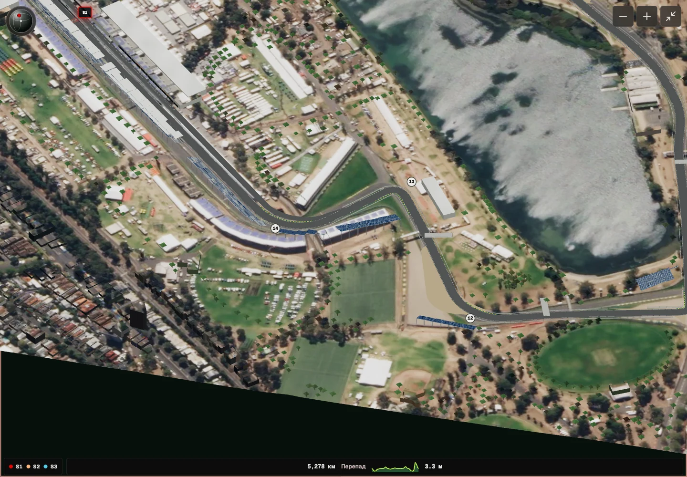

# Albert Park: итоговая сборка и проверка

Южный участок пересмотрен 4 октября 2026. Новая модель установлена на [локальной странице Австралии](http://127.0.0.1:3021/calendar/2026/1), ревизия GLB `812632008569`. Внешний production-сервер не обновлялся. Общий просмотрщик и управление не изменялись.

## Исправления T11–T14

У посетительской карты обнаружено смещение южного участка относительно постоянных дорожных координат. Независимое декодирование прежнего GLB выявило отклонение около 16,6 м у T12 и 14,6 м у T14. Соединение этой смещённой оси с native главной прямой создавало дополнительный изгиб после T14.

Весь участок заменён одной непрерывной последовательностью native OSM. Подход T11 выпрямлен согласно описанию реконструкции организатора; тесный поворот восстановлен касательной дугой оценочного радиуса 12 м. T12 и T14 сохраняют постоянные дорожные оси. Центр T13 смещён локально на 1 м наружу как оценка подтверждённого FIA переноса апексного поребрика на 2 м. Прежний поперечный переход после T14 удалён. Ширины полотна и радиус остаются оценочными.

Контроли изменённого подхода T11 относятся к современной прямой между её исходными конечными точками, а не к промежуточным узлам прежней обычной дороги. Референсы и допущения зафиксированы в [south-reference.json](track-model-albert-park-south-reference.json). Глобального масштабирования нет.

| Поворот | Прежнее отклонение оси | Итоговое отклонение от проверочных осей |
| --- | ---: | ---: |
| T11 | 18,625 м | 1,125 м |
| T12 | 16,625 м | 0,125 м |
| T13 | 7,875 м | 0,875 м |
| T14 | 14,625 м | 0,125 м |

Все 45 проверочных сечений имеют дорожную опору. Прямой выход T14 проверен по 450 пробам: край 12-метрового полотна отстоит от native оси максимум на 6,374 м при допуске 6,4 м. Регрессия проверяет координаты сжатого GLB, а не производные anchors. Прежняя модель этот тест не проходит. Числа отклонения показывают согласование с референсами реконструкции, а не геодезическую точность снимка.

## Привязка фотографии

Первоначальная гомография имела восемь контрольных точек и недостаточно опор у T13–T14. Добавлены четыре независимые дорожные точки; T12 исправлен с внешней белой линии на центр дороги. Гладкая коррекция остаточных ошибок не использует ось модели. Две точки проверки не участвуют в подгонке: остатки 3,62 и 2,43 пикселя, при ручной неопределённости около 3 м.

Широкая нарисованная асфальтовая полоса удалена из подложки. Фотография за пределами дорожного mesh сохраняется, поэтому её нельзя использовать для скрытия ошибок геометрии. Снимок остаётся историческим, от 22 марта 2018: старый широкий маршрут T11 отличается от современного тесного поворота, подтверждённого FIA. Подробности и источники: [карточка источников](track-model-albert-park-source-card.md).

## Бюджет и поверхности

| Проверка | Результат |
| --- | ---: |
| GLB / preview | 6 353 048 / 425 884 байт |
| Треугольники / draw calls / материалы | 211 390 / 31 / 19 |
| Текстурированные физические primitives | 25 / 25 |
| Meshopt / анимации | обязательный EXT_meshopt_compression / 0 |
| Длина оси / официальная FIA | 5 286,949 / 5 278 м |
| Отклонение длины | 0,16955%, допуск < 0,5% |
| Высоты AHD / вертикальное усиление | 3,001–6,254 м / 1 |
| Максимальный уклон | 4,572% |
| Зазор дороги / разметки | 0,650 / 0,196 м |
| Минимальный зазор мостов | 5,545 м |
| Конфликты объектов / отсутствующие текстуры / неправильные UV | 0 / 0 / 0 |

Сохранены 14 поворотов, 45 гаражных позиций, 19 трибун, 2 206 постоянных зданий, 2 845 отдельных деревьев, 9 пешеходных мостов. Pit Building 3 сохранён. Все физические объекты имеют встроенные изображения и UV; цвета и фасады частично реконструированы.

Главная прямая сохраняет native ось; прежние регрессии T6, пит-фронта и выезда проходят. Оценки высот согласованы в общих участках пит-лейна и основной дороги. Физический шов замыкания полотна закрыт точно, чтобы контрольная линия и разметка не оставались без опоры из-за микрозазора.

## Проверки

- Аудит источников и декодированного GLB: пройден.
- Семь тестов Albert Park и полный связанный набор: 146 / 146, без ошибок.
- Lint исходников, typecheck и production build: пройдены. Lint исключает сгенерированную директорию `.track-model-build`; конфигурация ESLint не менялась. Отдельного скрипта pnpm test нет, использован весь связанный node --test набор.
- 375, 768, 1024 и 1440 px в светлой и тёмной темах: 3D и fullscreen работают, горизонтального переполнения нет. На 375 px 3D открывается сразу полноэкранно; после закрытия доступна обычная схема.
- T11, T12, T13, T14 и главная прямая проверены на 800%; также осмотрены T1–T2, участок перед T6 и вся трасса сверху. Ошибок браузерной консоли нет.
- Браузер загрузил фактическую итоговую ревизию `812632008569`. На 3021 запущена финальная локальная сборка; отдельный существующий dev-сервер 3001 не затрагивался.

Контрольные изображения: [T11–T12](track-model-albert-park-review/t11-t12.webp), [T13–T14](track-model-albert-park-review/t13-t14.webp), [T11](track-model-albert-park-review/t11-corrected-800.webp), [T12](track-model-albert-park-review/t12-corrected-800.webp), [T13](track-model-albert-park-review/t13-corrected-800.webp), [T14](track-model-albert-park-review/t14-corrected-800.webp), [вся трасса](track-model-albert-park-review/whole-overhead.webp).

## Артефакты и ограничения

Редактируемый Blender-файл с упакованными текстурами: `.track-model-build/albert-park.blend`, 7 646 215 байт. Публичные GLB, preview и metadata заменены, компактный модуль данных содержит актуальную ревизию кеша. Машинный отчёт: [validation.json](track-model-albert-park-review/validation.json).

Подложка 2018 года не является современной ортосъёмкой; ручная геопривязка, радиусы, ширины, высоты, фасады и временные сооружения частично оценочные. Карта организатора обновляемая и может содержать временные объекты следующего мероприятия. Текущий статус означает проверенную локальную установку. GLB, preview и контрольные изображения модели — CC BY-SA 4.0; код сайта лицензируется отдельно.
